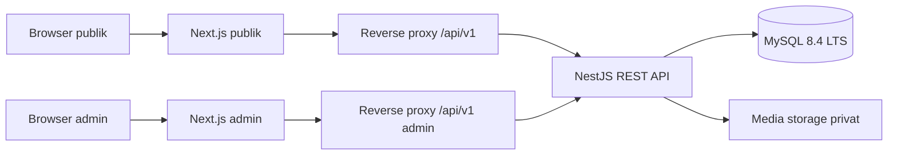

# Arsitektur usulan

## Komponen dan batas

`frontend/` berisi dua aplikasi Next.js JavaScript/CSS untuk publik dan admin pada origin berbeda. Fase 1 membangun fondasi `backend/`; Fase 2A menambahkan autentikasi admin, dan Fase 2B menambahkan kerangka frontend. Modul `public-content`, `resources`, `media`, `literacy-requests`, `clearance-requests`, dan `settings` masih rencana. `database/migrations/` menampung migrasi SQL dan snapshot Drizzle. Controller tidak berisi UI, dan komponen Next.js tidak mengakses MySQL.

Contoh origin produksi yang **belum dianggap tersedia**: `https://library.ith.ac.id` (publik), `https://admin.library.ith.ac.id` (admin), dan bila diperlukan `https://api.library.ith.ac.id` (akses API publik). Reverse proxy meneruskan `/api/v1` pada origin masing-masing ke NestJS. Sesi admin hanya melalui origin admin, sehingga cookie host-only `__Host-ith_admin` tidak perlu dibagikan lintas subdomain. Route admin di origin publik maupun API publik ditutup pada lapisan proxy dan tetap dijaga oleh NestJS. Domain, TLS, dan topologi aktual diputuskan pada Fase 6.

## Aliran utama

1. Publik meminta navigasi, pengaturan yang diizinkan, slide, konten terbit, dan sumber aktif; NestJS membaca MySQL dengan proyeksi field publik dan cache yang aman.
2. Formulir publik mengirim DTO ke `/api/v1/public/*-requests`; server melakukan validasi, normalisasi, rate limit, mitigasi bot, dan menulis status `PROSES`. Tidak ada sesi pemustaka.
3. Admin login melalui origin admin. NestJS memverifikasi Argon2id, membuat sesi opaque server-side, mengirim cookie aman, dan mencatat peristiwa autentikasi tanpa kredensial.
4. Setiap permintaan admin melewati session guard, permission guard, DTO validation, lalu service. Perubahan status, `request_status_history`, dan `audit_logs` terjadi dalam satu transaksi MySQL.
   Permission guard memakai allowlist: `ADMIN` hanya untuk ringkasan, daftar/detail, dan perubahan status dua permohonan; `SUPERADMIN` juga untuk seluruh pengelolaan website, akun, dan audit. Frontend menyaring navigasi dari izin backend, sedangkan akses URL/API langsung tetap diperiksa server.
5. Metadata media ada di MySQL; berkas disimpan di storage terpisah dengan validasi MIME/ukuran, nama acak, dan akses yang sesuai. Pilihan penyedia storage tetap terbuka.

## Pilihan data dan API

MySQL **8.4 LTS** dipilih sebagai seri yang stabil; pin patch yang masih didukung saat Fase 1 dan uji kompatibilitas driver/migrasi. [Dokumentasi MySQL](https://dev.mysql.com/doc/refman/8.4/en/mysql-releases.html) membedakan jalur LTS dan Innovation.

Drizzle ORM + `mysql2` dipilih karena skema TypeScript, parameterisasi query, kontrol SQL/indeks/constraint, dan transaksi eksplisit cocok untuk audit status. Migrasi SQL berversi dibuat dengan Drizzle Kit, diperiksa manusia, lalu dijalankan di lingkungan yang tepat; `push` langsung ke produksi dilarang. Dokumentasi resmi: [MySQL](https://orm.drizzle.team/docs/get-started/mysql-new), [migrasi](https://orm.drizzle.team/docs/migrations), [transaksi](https://orm.drizzle.team/docs/transactions). Pilihan ini dikunci sebagai rancangan, bukan dependensi yang sudah dipasang.

REST JSON memakai `/api/v1`, DTO NestJS dan validasi server, OpenAPI/Swagger yang dibatasi pada lingkungan/akses sesuai kebijakan. Detail kontrak di `API_CONTRACT.md`. Versi paket NestJS, Next.js, Drizzle, Node.js dan driver dikunci pada awal Fase 1 setelah cek dukungan rilis, bukan ditebak dalam Fase 0.

## Keputusan operasional

- Tanggal/waktu disimpan UTC dengan presisi milidetik; UI menampilkan zona waktu yang dikonfigurasi (default institusi perlu dipastikan).
- Konten publik dan data pribadi dipisah pada service, DTO respons, dan kebijakan cache (`no-store` untuk seluruh data admin/form). Tidak ada HTML mentah dari penyunting konten tanpa sanitasi/allowlist.
- Liveness `/api/v1/health` hanya menunjukkan proses berjalan. Readiness `/api/v1/ready` memeriksa query `SELECT 1` melalui pool MySQL; respons publiknya hanya status siap/tidak siap tanpa kredensial, konfigurasi, atau rincian infrastruktur. Pool dibuat melalui dependency injection, memakai timeout dan ditutup saat shutdown.
- Backup terenkripsi dan uji restore dijadwalkan sebelum produksi. Retensi permohonan/audit membutuhkan keputusan institusi; tidak diasumsikan tanpa batas.
