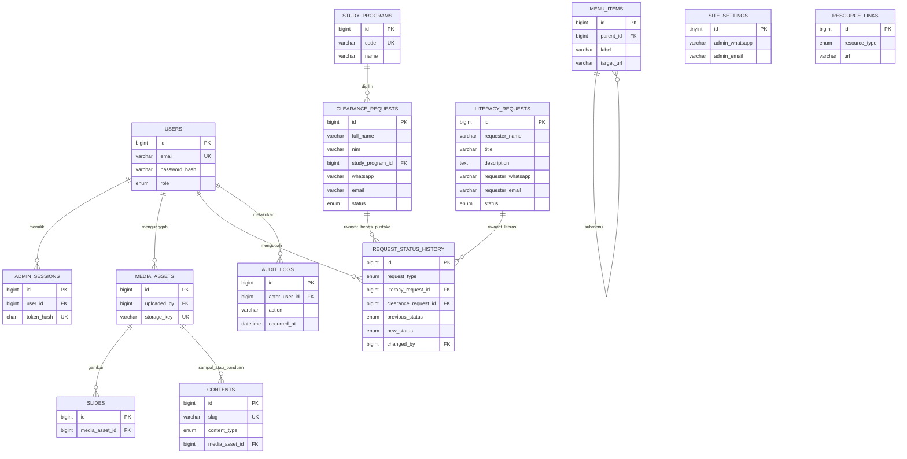

# Rancangan database MySQL

Status: skema TypeScript Fase 1 di `backend/src/database/schema.ts` dan migrasi awal SQL berversi di `database/migrations/0000_amusing_the_hood.sql`. Target MySQL 8.4 LTS, InnoDB, `utf8mb4`, waktu UTC (`DATETIME(3)`). Semua ID internal `BIGINT UNSIGNED` auto increment kecuali bila dinyatakan lain. Nama kolom menggunakan `snake_case`. Relasi memakai FK fisik dan perilaku penghapusan konservatif (`RESTRICT` untuk data historis). Migrasi ini telah diterapkan pada MySQL 8.4.13 lokal yang baru/kosong dan diperiksa melalui `npm run test:db`.

## ERD



`request_status_history` mempunyai tepat satu dari `literacy_request_id` dan `clearance_request_id`, dijaga oleh `CHECK` SQL dan validasi service. `request_type` harus cocok dengan FK yang terisi. Dua FK ini dipilih agar integritas referensial tetap nyata; pasangan polimorfik `request_type + request_id` saja tidak dapat diberi FK ke dua tabel. Rincian `CHECK` diperiksa pada migrasi MySQL yang ditargetkan.

## Kamus tabel

| Tabel | Kolom inti dan aturan | Indeks/relasi penting |
| --- | --- | --- |
| `users` | `id`, `email VARCHAR(254)` unik, `display_name VARCHAR(160)`, `password_hash VARCHAR(255)`, `role ENUM('SUPERADMIN','ADMIN')`, `is_active BOOLEAN`, `created_at`, `updated_at` | Email unik; tidak ada registrasi publik. Sandi hanya hash Argon2id. Migrasi maju Fase 2 membatasi enum tanpa menaikkan hak akun lama. |
| `admin_sessions` | `id`, `user_id`, `token_hash CHAR(64)` unik, `created_at`, `last_seen_at`, `idle_expires_at`, `absolute_expires_at`, `revoked_at` nullable | FK `user_id`; indeks expiry dan user. Hanya hash token yang disimpan. |
| `site_settings` | singleton `id TINYINT UNSIGNED = 1`, `admin_whatsapp VARCHAR(20) NULL`, `admin_email VARCHAR(254) NULL`, `institution_name`, `updated_at`, `updated_by` nullable | Baris tunggal; API publik hanya proyeksi kontak dan identitas yang diizinkan. Kedua kontak wajib terisi dan tervalidasi sebagai gerbang sebelum situs tayang. |
| `menu_items` | `id`, `parent_id` nullable, `label VARCHAR(120)`, `target_url VARCHAR(2048)`, `position INT`, `is_active BOOLEAN`, timestamps | FK self; indeks `(parent_id, position, is_active)`. Validasi siklus, kedalaman submenu, internal path atau HTTPS eksternal di service. |
| `contents` | `id`, `slug VARCHAR(180)` unik, `content_type ENUM('PROFILE','VISION_MISSION','ORG_STRUCTURE','STAFF_PROFILE','NEWS','RESEARCH_SERVICE','GUIDE')`, `title VARCHAR(255)`, `body LONGTEXT`, `media_asset_id` nullable, `is_published BOOLEAN`, `published_at` nullable, timestamps | FK media; indeks `(content_type, is_published, published_at)`. Konten terbit saja di publik; HTML disanitasi. |
| `resource_links` | `id`, `resource_type ENUM('REPOSITORY_ITH','INDONESIA_ONESEARCH','E_JOURNAL','E_BOOK')`, `title`, `description` nullable, `url VARCHAR(2048)`, `position`, `is_active`, timestamps | Indeks `(resource_type, is_active, position)`; URL HTTPS divalidasi. |
| `slides` | `id`, `media_asset_id`, `title`, `caption` nullable, `target_url` nullable, `position`, `is_active`, timestamps | FK media; indeks `(is_active, position)`. |
| `media_assets` | `id`, `storage_key` unik, `original_name`, `mime_type`, `size_bytes BIGINT UNSIGNED`, `alt_text` nullable untuk berkas bukan gambar, `uploaded_by`, `created_at` | FK uploader; nama storage acak, path bukan input klien. Gambar publik wajib mempunyai alt text; status aman/rujukan diverifikasi saat publikasi. |
| `literacy_requests` | `id`, `requester_name VARCHAR(160)`, `title VARCHAR(255)`, `description TEXT`, `requester_whatsapp VARCHAR(20) NULL`, `requester_email VARCHAR(254) NULL`, `status ENUM('PROSES','SELESAI') DEFAULT 'PROSES'`, timestamps | Indeks `(status, created_at, id)` dan pencarian nama/judul sesuai kebutuhan terukur. Dua kontak dapat sama-sama `NULL`. |
| `clearance_requests` | `id`, `full_name VARCHAR(160)`, `nim VARCHAR(32)`, `study_program_id`, `whatsapp VARCHAR(20)`, `email VARCHAR(254)`, `status ENUM('PROSES','SELESAI') DEFAULT 'PROSES'`, timestamps | FK program studi; indeks `(status, created_at, id)`, `nim`, `study_program_id`. NIM tidak unik karena pengajuan ulang sah. |
| `request_status_history` | `id`, `request_type ENUM('LITERACY','CLEARANCE')`, dua FK permohonan saling eksklusif, `previous_status ENUM('PROSES','SELESAI')`, `new_status` enum sama, `changed_by`, `changed_at` | FK permohonan dan admin; indeks `(literacy_request_id, changed_at)` dan `(clearance_request_id, changed_at)`. Hanya transisi admin yang benar-benar berubah dicatat. |
| `audit_logs` | `id`, `actor_user_id` nullable, `action VARCHAR(80)`, `entity_type VARCHAR(80)`, `entity_id` nullable, `outcome`, `occurred_at`, metadata terbatas | FK actor, indeks `(actor_user_id, occurred_at)` dan `(entity_type, entity_id, occurred_at)`. Metadata tidak boleh berisi isi formulir, email/WA, sandi, cookie, atau token. |
| `study_programs` | `id`, `code VARCHAR(40)` unik, `name VARCHAR(180)`, `is_active`, timestamps | Program nonaktif tidak bisa dipilih untuk pengajuan baru; data lama tetap mengacu padanya. |

Kolom `created_at`/`updated_at` wajib untuk tabel operasional sebagaimana relevan. Nilai boolean dan enum dijaga juga oleh DTO/service. Kolom bebas teks diberi batas panjang server dan database; tidak ada penyimpanan nilai kontak literasi kosong sebagai `''`.

### Invarian fisik yang harus ada dalam migrasi awal

```sql
-- Ilustrasi constraint; nama constraint dan DDL penuh ditetapkan saat migrasi Fase 1.
CHECK (id = 1) -- site_settings
CHECK (
  (request_type = 'LITERACY' AND literacy_request_id IS NOT NULL AND clearance_request_id IS NULL)
  OR
  (request_type = 'CLEARANCE' AND literacy_request_id IS NULL AND clearance_request_id IS NOT NULL)
) -- request_status_history
CHECK (previous_status <> new_status) -- request_status_history
```

Kolom kontak literasi tetap nullable tanpa constraint `at least one contact`. `clearance_requests.nim` bukan `UNIQUE` dan bukan FK ke tabel anggota. FK ke program studi memakai `ON DELETE RESTRICT`; perubahan nama/nonaktif program tidak merusak permohonan lama. Indeks dan constraint ini harus dicek pada MySQL target menggunakan integration test, bukan diasumsikan dari definisi ORM saja.

## Aturan transaksi dan migrasi

Migrasi awal hasil Drizzle memuat 13 tabel domain, 11 FK, 23 indeks sekunder eksplisit (termasuk 5 unik), dan 3 CHECK. Verifikasi `information_schema` pada MySQL 8.4.13 menunjukkan **13 tabel domain + 1 ledger migrasi, 11 FK, 24 indeks sekunder** (23 eksplisit dan 1 yang dibuat MySQL untuk FK), 3 CHECK, serta database `utf8mb4`/`utf8mb4_0900_ai_ci`. Kontak literasi nullable, status kedua permohonan default `PROSES`, dan ledger memuat satu migrasi. Konfigurasi Docker mematok server `utf8mb4`/`utf8mb4_0900_ai_ci` dan zona waktu `+00:00`; instalasi MySQL alternatif harus disetel setara. `drizzle-kit check` memeriksa berkas migrasi; `drizzle-kit migrate` menerapkannya tanpa drop otomatis.

Uji pertama pada database lokal `ith_library` berhenti setelah 6 FK karena dua nama constraint otomatis melebihi batas 64 karakter MySQL. Schema diberi nama FK eksplisit yang pendek dan migrasi awal dibuat ulang sebelum commit. Database parsial **tidak dihapus**; uji ulang memakai database baru `ith_library_v1` yang dipastikan memiliki 0 tabel sebelum migrasi. Nama database tersebut hanya bukti pengujian lokal, bukan nama wajib produksi.

Migrasi maju `0001_restrict_admin_roles.sql` mengubah enum `users.role` menjadi `SUPERADMIN`/`ADMIN` tanpa mengganti migrasi awal yang sudah dijalankan. Script preflight memeriksa akun dengan role lama dan menghentikan proses bila ada. Pemeriksaan pada database lokal menemukan 0 akun tersebut; migrasi berhasil dan ledger kini berisi dua entri. Jika database lain memilikinya, operator harus meninjau akun itu; tidak ada promosi otomatis. Skema database tidak mengkodekan izin per role; permission allowlist dijaga dan diuji di backend.

- `POST` publik menetapkan `PROSES` di service, bukan mengambil `status` dari body. Database juga memberi default sebagai lapisan cadangan. Kontak literasi di-trim, kosong menjadi `NULL`, nilai yang terisi divalidasi lalu dinormalisasi secara konsisten.
- Perubahan status mengunci baris permohonan di transaksi, membandingkan status lama, memperbarui bila berbeda, menulis satu `request_status_history`, dan menulis satu `audit_logs`; semuanya commit/rollback bersama. Permintaan status sama bersifat idempotent dan tidak membuat riwayat palsu.
- Migrasi Drizzle SQL disimpan berversi, dikaji diff/constraint/indeks, diuji pada salinan data, dan di-backup sebelum produksi. Jangan gunakan `drizzle-kit push` untuk produksi atau drop/recreate tabel yang berisi data.
- Jika kelak ditemukan data lama, audit skema dan hitung nilai kosong/status lama lebih dulu. Migrasi nullable dilakukan secara aditif, backfill terukur (`''` ke `NULL` bila sesuai), validasi hasil, kemudian constraint baru. Tidak ada asumsi bahwa data lama aman dihapus.
- Kebijakan retensi dan penghapusan terkontrol perlu disetujui institusi; operasi penghapusan harus menjaga jejak audit yang sesuai tanpa menahan PII lebih lama dari kebijakan.
